# Hi there, I'm Saad Bin Kabir 👋

**Full-stack developer · Designer · Engineering student · Hardware tinkerer**

[Email](mailto:saadbinkabir2020@gmail.com) · [Instagram](https://instagram.com/saaad.dng) · [Spotify](https://open.spotify.com/user/31wk3dkdkvzcmqjx63q2mf2r2qle?si=61abe248e5ef4494) · [Discord](https://discord.com/users/747004636136996954)

---

I'm 20, constantly jumping between software, electronics, and whatever random idea refuses to leave my head at 3AM.

I'm drawn to modern aesthetics, obsessive attention to detail, seamless digital experiences, and the chaotic but fascinating world of **local AI, LLMs, microcontrollers, and custom Linux environments**.

**I use Arch btw.**

---

## 🚀 What I'm Currently Up To

| | |
|---|---|
| 💻 **Portfolio** | A responsive bento-grid experience using **React, TypeScript, Vite, and Tailwind CSS** |
| ⚡ **Hardware** | A smart calculator built around the **Seeed Studio XIAO ESP32-S3**, plus camera-to-AI bridges and microcontroller integration, because apparently a normal calculator wasn't interesting enough |
| 🎙️ **Local "Jarvis"** | Local LLMs, speech-to-text models, and terminal automation for a more natural way of interacting with my workspace |
| 🐧 **Arch + Hyprland** | Ricing my setup, obsessing over dotfiles, terminal emulators, workflows, and tiny details nobody else will notice |
| 📐 **Design** | Minimal, glassmorphic interfaces, and the space between polished digital experiences and raw hardware |

---

## 📦 Things I've Built (So Far)

- **Tracking Planet**: a real-time web-based device tracking application built and deployed for live monitoring
- **Deep OS Customization**: custom ROMs, modified rooted Android devices, and stripped-down, optimized Windows environments
- **One Hours Odyssey**: a personal curation space on YouTube dedicated to crafting atmospheric 1-hour music loops

---

## 🛠️ The Tech Omnivore's Stack

| | |
|---|---|
| **Frontend & Design** |  |
| **Backend, AI & Hardware** |  |
| **Environment & Tooling** |  |

---

## 🌌 Beyond the Screen

There's a lot more to me than code. I've always been drawn to things that let me **observe, create, and understand**.

📸 **Photography** is how I slow down. I walk around with a camera looking for details that would otherwise disappear into the background: unusual light, architecture, people, cars, empty streets, clouds, or a moment that just feels right. I'm less interested in making everything look perfect and more interested in capturing a certain **mood**.

🎧 **Music** works the same way. Atmospheric R&B, alternative rock, lo-fi, and songs that feel almost cinematic. I like music that creates a place in your head, and I'll spend an unreasonable amount of time on a playlist because the transition between two songs doesn't feel quite right.

⚙️ **Machines** are the third thing. Cars, engines, drones, electronics, rockets, motors: carefully designed parts becoming something alive and functional. I enjoy understanding the mechanics as much as using them, which is probably what keeps pulling me between software and hardware.

When I'm not doing any of that, I'm probably gaming, running, editing photos, experimenting with Linux, designing something unnecessarily complicated, or down a completely unrelated internet rabbit hole.

---

## 🌙 The 3AM Ideas

They start with *"I wonder if I could build that."*
Then become *"Wait, how does this actually work?"*
And somehow end with a folder full of code, a half-finished prototype, and several tabs that have been open for three days.

Most of them go nowhere. A few become projects.

I think that's what connects everything I'm interested in: **I like figuring things out.** Making things, taking things apart, questioning how they were designed, and occasionally rebuilding them just because I can.

---

## 📫 Let's Connect

📧 **Email:** `saadbinkabir2020@gmail.com`
📸 **Instagram:** [@saaad.dng](https://instagram.com/saaad.dng)
🎧 **Spotify:** [Saad Bin Kabir](https://open.spotify.com/user/31wk3dkdkvzcmqjx63q2mf2r2qle?si=61abe248e5ef4494)
💬 **Discord:** [Saad Bin Kabir](https://discord.com/users/747004636136996954)
🌐 **Website:** *Coming soon, currently under development.*

 

